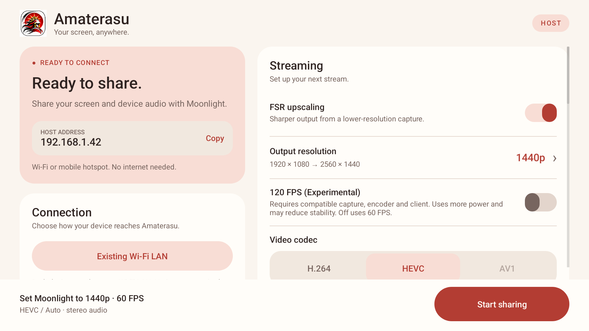

# Amaterasu

Your screen, anywhere.

Amaterasu streams your Android screen and device audio to compatible Moonlight or Artemis clients over Wi-Fi or a hotspot. Bring games, lessons, or presentations to a bigger screen, even offline. Vibe coded with Codex, for the people.

[Download Amaterasu v0.6.7 (experimental prerelease)](https://github.com/VishantEXE/Amaterasu/releases/tag/v0.6.7)

## Connect a device

1. Connect your Android host and receiving device to the same Wi-Fi network or hotspot. Internet access is not required.
2. Open Amaterasu. In Moonlight on the receiving device, select **Amaterasu**, or add the host address shown in the app.
3. If prompted to pair, expand **Connect a device** in Amaterasu and enter the four-digit PIN shown by Moonlight.
4. Choose your stream settings. Set Moonlight to the output resolution and frame rate shown above Amaterasu’s sharing button.
5. Tap **Start sharing** and approve Android’s screen-sharing prompt. In Moonlight, launch **Screen**, then switch to your game or app on the host.

Tap **Stop sharing** in Amaterasu or its notification to end a session. Stop sharing before changing stream settings. Android device audio capture works with apps that allow playback capture.

In **Connection**, select **Direct Wi-Fi Hotspot** to use the host device’s hotspot. Tap **Android hotspot settings** to turn it on, choose 5 GHz if available, and find its Wi-Fi name and password. Turn off automatic hotspot shutdown for long sessions. Join that network from the receiver, then use the displayed host address if discovery fails. Select **Existing Wi-Fi LAN** when both devices join an external hotspot.

Open **Live stats** while sharing to see host encoder and sender FPS, video payload bitrate, the current encoder target, and recent drops. The protected panel stays on the host. The reported rates describe the host, while receiver playback statistics are available in the client.

Amaterasu remembers multiple paired clients and keeps its host identity across networks. If the IP address changes and discovery misses it, add the new address in the client. Moonlight XR can match it to the existing host entry.

## Stream settings

| Setting | Options |
| --- | --- |
| Video | Hardware H.264, HEVC, or experimental AV1, where supported |
| Frame rate | 60 FPS default; optional 120 FPS (Experimental) |
| Bitrate limit | 10–200 Mbps; client and hardware limits also apply |
| FSR off | Native 1920×1080 |
| FSR on | 720p → 1080p, 1080p → 1440p, 1080p → 4K |

Amaterasu can lower its bitrate when the sender falls behind. Actual frame rate depends on the source app, host hardware and connection. The Odin2 Portal with stock Moonlight XR on Quest 3 is the primary tested setup; the UI uses device-neutral Moonlight instructions.

## Interface

Native Android views, automatic light/dark themes, a vermilion and warm-paper palette, and a sun emblem. The layout adapts to handheld landscape and phone portrait screens, with the sharing action always visible.

The images in this repository are native Android layout-renderer previews with example addresses, not gameplay screenshots.

## Development

Build instructions and pinned dependencies are in [tools/host-discovery/README.md](tools/host-discovery/README.md). The existing upgrade variant uses the historical `-SideBySide` flag and package `dev.questheld.host.pacing`; that identity is retained to preserve installed users’ pairing and preferences. Its launcher and Moonlight discovery name are **Amaterasu**.

See [validation and known limitations](docs/VALIDATION.md) and [third-party notices](THIRD_PARTY_NOTICES).

## Version 0.6.7 — experimental

Supports local Wi-Fi and Android system hotspot setup, optional host-media mute, opt-in screen dimming with saved-state recovery, session diagnostics and in-app license notices. Dimming requires Android's modify-system-settings permission. If host audio remains audible, set host media volume to zero; captured stream audio can continue.

Start at 1080p/60 with a modest bitrate. The Odin’s 5 GHz hotspot performed better than 2.4 GHz in the tested setup. Android can still terminate the foreground host under memory pressure, including in the v0.6.7 4K FSR retest. AV1 is hardware-only and live AV1 playback still needs validation on a compatible Android host.

Amaterasu's own source and supplied app artwork are licensed under [GPL-3.0-only](LICENSE). Bundled components retain the licenses and notices in [THIRD_PARTY_NOTICES](THIRD_PARTY_NOTICES). Release assets include a development-signed arm64 APK, corresponding source, and checksums.
