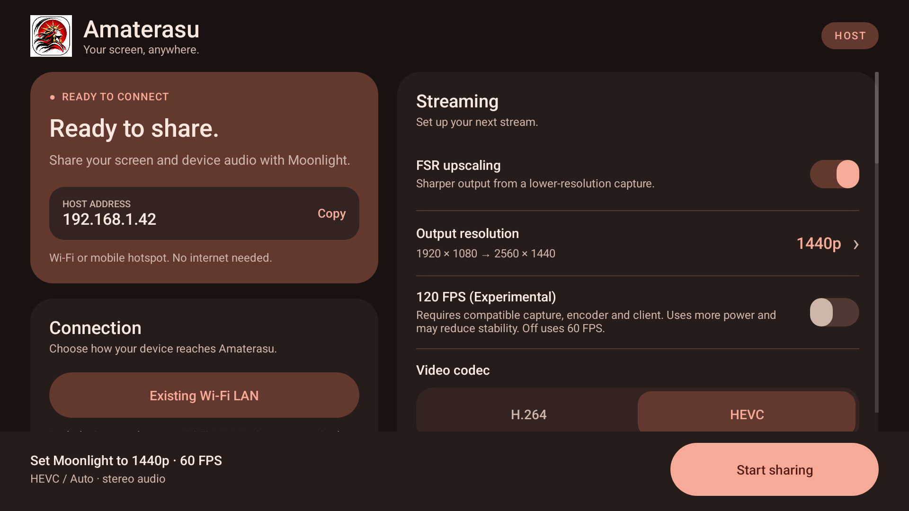

# Amaterasu

Your screen, anywhere.

Amaterasu is an Android streaming host for compatible Moonlight clients. Share your Android screen and device audio over local Wi-Fi or a mobile hotspot, with optional host-side FSR upscaling.

## Connect a device

1. Connect your Android host and receiving device to the same Wi-Fi network or hotspot. Internet access is not required.
2. Open Amaterasu. In Moonlight on the receiving device, select **Amaterasu**, or add the host address shown in the app.
3. If prompted to pair, expand **Connect a device** in Amaterasu and enter the four-digit PIN shown by Moonlight.
4. Choose your stream settings. Set Moonlight to the output resolution and frame rate shown above Amaterasu’s sharing button.
5. Tap **Start sharing** and approve Android’s screen-sharing prompt. In Moonlight, launch **Screen**, then switch to your game or app on the host.

Tap **Stop sharing** in Amaterasu or its notification to end a session. Stop sharing before changing stream settings. Android device audio capture works with apps that allow playback capture.

## Stream settings

| Setting | Options |
| --- | --- |
| Video | Hardware H.264 or HEVC, where supported |
| Frame rate | 60 FPS default; optional 120 FPS (Experimental) |
| Bitrate limit | 10–200 Mbps; client and hardware limits also apply |
| FSR off | Native 1920×1080 |
| FSR on | 720p → 1080p, 1080p → 1440p, 1080p → 4K |

Amaterasu can lower its bitrate when the sender falls behind. Actual frame rate depends on the source app, host hardware and connection. The Odin2 Portal with stock Moonlight XR on Quest 3 is the primary tested setup; the UI uses device-neutral Moonlight instructions.

## Interface

Native Android views, automatic light/dark themes, a vermilion and warm-paper palette, and a sun emblem. The layout adapts to handheld landscape and phone portrait screens, with the sharing action always visible.

The images in this repository are native Android layout-renderer previews with example addresses, not gameplay screenshots.

## Development

Build instructions and pinned dependencies are in [tools/host-discovery/README.md](tools/host-discovery/README.md). The existing upgrade variant uses the historical `-SideBySide` flag and package `dev.questheld.host.pacing`; that identity is retained to preserve installed users’ pairing and preferences. Its launcher and Moonlight discovery name are **Amaterasu**.

See [validation and known limitations](docs/VALIDATION.md) and [third-party notices](THIRD_PARTY_NOTICES).

## Version 0.6.1 — experimental

Supports local Wi-Fi and public Android local-only hotspot setup, optional host-media mute, opt-in screen dimming with saved-state recovery, session diagnostics and in-app license notices. Dimming requires Android's modify-system-settings permission. If host audio remains audible, set host media volume to zero; captured stream audio can continue.

Start with 1080p at 60 FPS and a modest bitrate. Heavy games with 4K FSR have triggered Android LOW_MEMORY termination of the host. This remains unresolved. 120 FPS and higher resolutions depend on encoder, client, network and source performance.

Amaterasu's own source and supplied app artwork are licensed under [GPL-3.0-only](LICENSE). Bundled components retain the licenses and notices in [THIRD_PARTY_NOTICES](THIRD_PARTY_NOTICES). Provide matching corresponding source, including pinned dependency sources, when distributing binaries. This repository contains source, not a production-signed APK release.
